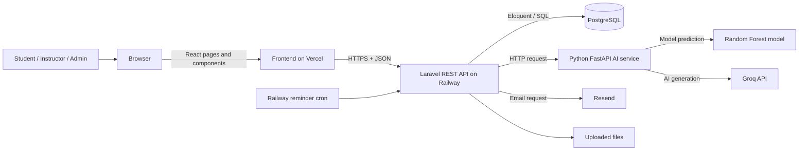
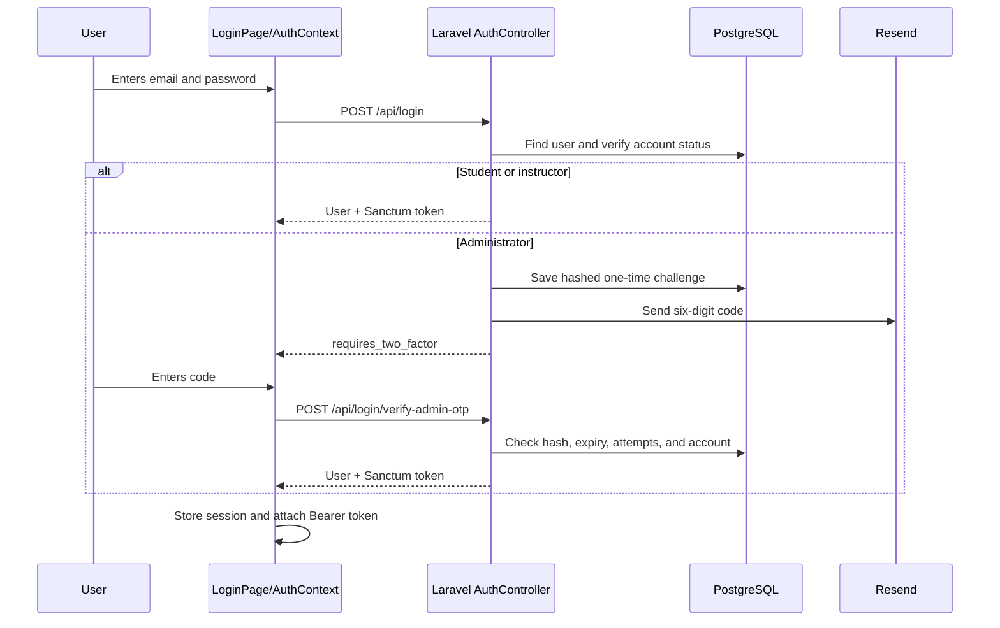
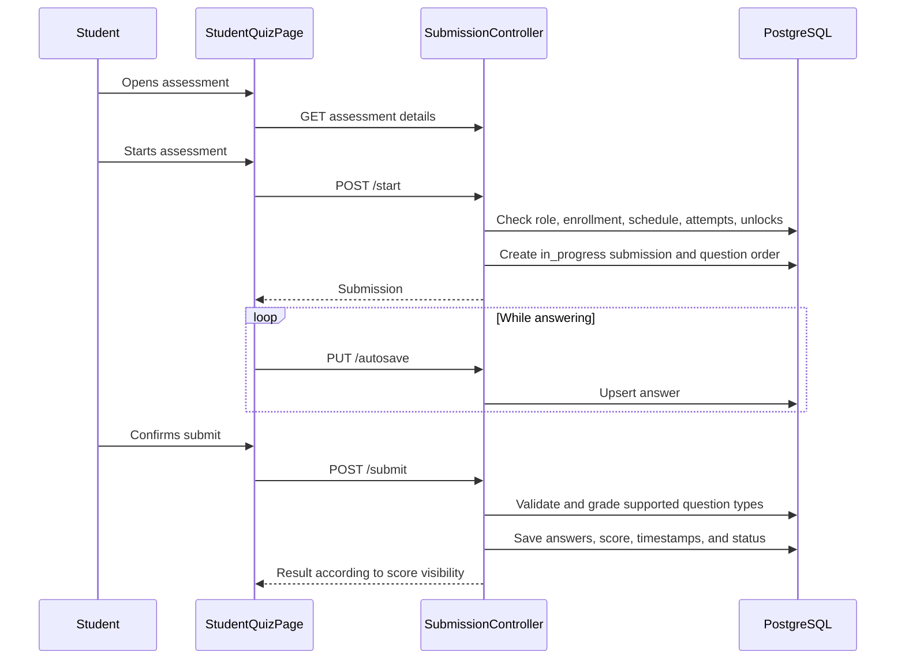
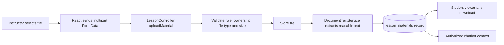
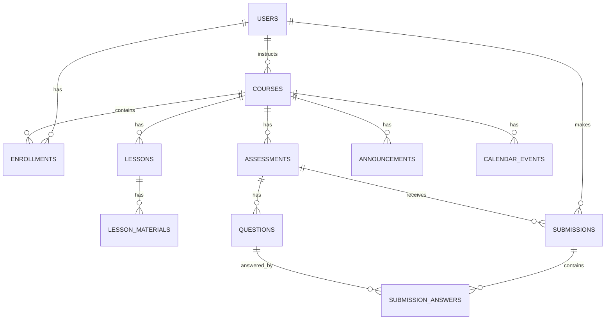

# IntelliLearn Title Defense Training Guide

This guide prepares the proponents to explain and demonstrate the actual IntelliLearn system. It focuses on understanding the architecture, locating the code behind a feature, explaining the data flow, and answering panel questions clearly. It is not a line-by-line programming course.

## Training goal

By the end of the training, every proponent should be able to:

1. Explain what the frontend, backend, API, database, AI service, and deployment platforms do.
2. Trace a user action from the browser to the database and back.
3. Locate the important folders and files without guessing.
4. Explain how authentication, authorization, validation, assessments, AI, email, and file storage work.
5. State the system's limitations honestly and explain how errors are handled.
6. Demonstrate the system while narrating what happens behind the screen.

## Recommended format

Use three sessions if possible. Each session can run for 2 to 3 hours.

| Session | Subject | Expected result |
|---|---|---|
| 1 | Architecture and code navigation | They can identify every major layer and find the code for a feature. |
| 2 | Backend, database, security, and assessments | They can trace login and quiz submission and explain the database records involved. |
| 3 | AI, deployment, failure handling, and mock defense | They can explain the AI honestly, diagnose common failures, and answer panel questions. |

If only two sessions are available, combine Sessions 1 and 2, then use Session 3 for AI and the mock defense.

---

# Session 1: Understand the whole system

## 1. Start with the one-minute explanation

Each proponent should practice this answer:

> IntelliLearn is a web-based learning management system with three user roles: student, instructor, and administrator. The user interface is built with React and runs in the browser. It sends HTTP requests through a REST API to a Laravel backend. Laravel validates requests, applies the business rules, reads or writes records in PostgreSQL, and returns JSON responses. AI tasks are sent by Laravel to a separate Python FastAPI service. Vercel hosts the frontend, while Railway hosts the Laravel API, PostgreSQL database, AI service, and scheduled reminder job. Resend delivers application emails.

They should understand every noun in that paragraph.

## 2. The system layers



### What each part means

- **Frontend:** Everything the user sees and interacts with. It displays data and sends requests. It must not be trusted to enforce important rules by itself.
- **Backend:** The server-side application. It validates data, checks permissions, enforces rules, performs calculations, and controls database access.
- **API:** The agreed set of URLs and request/response formats used by the frontend and backend to communicate.
- **Database:** Persistent structured data such as users, courses, questions, submissions, and grades.
- **AI service:** A separate Python application for prediction and generative AI work.
- **Third-party service:** An external system, such as Groq or Resend, called through an API.
- **Deployment:** The process and configuration that make the applications available online.

## 3. Technology stack in the current code

| Layer | Technology | Purpose |
|---|---|---|
| Frontend | React 19, React Router, Axios, Material UI, Vite | Pages, navigation, HTTP requests, and interface components |
| Backend | PHP 8.4, Laravel 13, Laravel Sanctum | REST API, validation, authentication, authorization, and business rules |
| Database | PostgreSQL | Persistent relational data |
| AI service | Python, FastAPI, scikit-learn, NumPy, Groq SDK | Risk prediction, grounded chatbot, quiz/rubric drafting, essay assistance |
| Email | Laravel Mail with Resend | Admin login codes, verification, password reset, and reminders |
| Hosting | Vercel and Railway | Frontend and server services |

Do not say that React connects directly to PostgreSQL. It connects to Laravel, and Laravel connects to PostgreSQL.

## 4. Repository map

Open these folders during the lesson:

```text
intellilearn/
|-- frontend/                 React application
|   |-- src/App.jsx           Browser routes and role-protected pages
|   |-- src/pages/            Full pages grouped by role
|   |-- src/components/       Reusable interface components
|   |-- src/context/          Shared state such as authentication and theme
|   `-- src/services/api.js   Axios API connection and token handling
|-- routes/api.php            Laravel API endpoint map
|-- app/Http/Controllers/     Request handling and business workflows
|-- app/Models/               Database entities and relationships
|-- app/Services/             Reusable domain logic
|-- app/Http/Requests/        Request validation classes
|-- database/migrations/      Database schema history
|-- ai-service/               Python FastAPI application and ML model
|-- config/                   Laravel service, mail, database, and storage settings
|-- scripts/                  Deployment startup scripts
|-- railway.json              Laravel Railway configuration
|-- railway-reminders.json    Reminder job configuration
`-- frontend/vercel.json      Frontend routing and cache configuration
```

### How to answer “Where is this function?”

Use this search order:

1. Find the page in `frontend/src/pages`.
2. Find the `api.get`, `api.post`, `api.put`, or `api.delete` call.
3. Find the same URL in `routes/api.php`.
4. Follow the route to its controller and method.
5. Inspect the models or services called by that method.
6. Find the corresponding migration if the panel asks about the database field.

## 5. API anatomy

Example:

```text
POST /api/courses/2/assessments/8/submit
Authorization: Bearer <token>
Content-Type: application/json

{
  "answers": [...]
}
```

- `POST` means create or execute an action.
- `/api/...` identifies the endpoint.
- The bearer token identifies the logged-in user.
- JSON is the request body format.
- Laravel returns a status code and JSON response.

Important status codes:

| Code | Meaning in IntelliLearn |
|---|---|
| 200 | Successful request |
| 201 | A record was created |
| 401 | Missing or invalid login token |
| 403 | Logged in but not allowed, not enrolled, or outside an allowed rule |
| 404 | Record or route not found |
| 409 | State conflict, such as unavailable material context |
| 422 | Validation failed |
| 423 | Assessment attempt is locked |
| 429 | Too many requests |
| 500 | Unhandled server-side error |
| 502/503 | AI or email provider unavailable, timed out, or rate limited |

## Session 1 practical exercise

Give each proponent one feature. They have five minutes to find:

- its frontend page or component;
- its API URL;
- its route;
- its controller method;
- its primary model/table.

Suggested features: login, create course, upload lesson, start assessment, submit assessment, view grades, AI chatbot, and admin user search.

---

# Session 2: Trace real backend workflows

## Workflow A: Login and admin two-step verification



### Code locations

- Frontend login state: `frontend/src/context/AuthContext.jsx`
- Axios bearer token: `frontend/src/services/api.js`
- Public routes: `routes/api.php`
- Credential and OTP logic: `app/Http/Controllers/Auth/AuthController.php`
- User record: `app/Models/User.php`
- OTP table: migration containing `admin_login_challenges`

### Important explanation

Passwords and one-time codes are compared through hashes; the plain password is not stored. Laravel Sanctum creates an API token after successful authentication. Protected routes use the `auth:sanctum` middleware. Role checks inside controllers prevent a student from performing instructor or administrator actions.

## Workflow B: Student takes a quiz



### Code locations

- Quiz interface, timer, autosave, warning, submit confirmation: `frontend/src/pages/student/StudentQuizPage.jsx`
- Assessment routes: `routes/api.php`
- Start/autosave/lock/submit: `app/Http/Controllers/SubmissionController.php`
- Assessment rules: `app/Models/Assessment.php`
- Attempt record: `app/Models/Submission.php`
- Answer record: `app/Models/SubmissionAnswer.php`
- Question record: `app/Models/Question.php`

### Rules enforced by the backend

The backend checks the student role, enrollment, course ownership of the assessment, publication state, availability dates, attempt count, per-student unlock, and locked state. Question order can be stored per submission, so refreshing does not create a new random order. Autosave preserves progress. The frontend timer improves the experience, while the backend controls whether an attempt remains valid.

### Why both frontend and backend validation are needed

Frontend validation gives immediate feedback. Backend validation provides security because a user can bypass the interface and call an endpoint directly. Important rules must therefore be enforced in Laravel.

## Workflow C: Instructor uploads a lesson material



### Code locations

- Lesson creation page: `frontend/src/pages/instructor/InstructorCreateLessonPage.jsx`
- Upload endpoint: `routes/api.php`
- Upload workflow: `app/Http/Controllers/LessonController.php`, method `uploadMaterial`
- Text extraction: `app/Services/DocumentTextService.php`
- Stored material: `app/Models/LessonMaterial.php`
- Retrieval for AI: `app/Services/MaterialContextService.php`

The database stores metadata and extracted text. The uploaded binary file is stored through Laravel's storage system. The exact production disk depends on deployment environment variables, so do not claim that database rows contain the entire PDF.

## Database concepts they must know

### Primary key and foreign key

- A primary key uniquely identifies a row, commonly `id`.
- A foreign key connects a row to another table, such as `assessments.course_id` pointing to `courses.id`.

### Core relationships



### Models versus migrations

- A **migration** defines or changes the database structure.
- A **model** represents a table in Laravel and defines relationships, casts, and permitted fields.
- A **controller** decides what to do for an HTTP request.
- A **service** holds reusable or specialized business logic.

## Security checklist they should explain

1. Passwords use Laravel hashing.
2. Authenticated APIs require Sanctum bearer tokens.
3. Controllers check roles, ownership, and enrollment.
4. Laravel validation restricts field formats and file uploads.
5. Admin login requires an emailed code with expiry and attempt limits.
6. Login and AI generation endpoints are rate limited.
7. Email verification and password reset use controlled links/tokens.
8. Secrets are environment variables on Vercel or Railway, not hard-coded into frontend source.
9. Material context is resolved and authorized on the server before being sent to AI.
10. Errors return controlled messages; sensitive keys should never appear in responses or logs.

## Session 2 practical exercise

Each proponent explains one workflow using this formula:

> The user action starts in **[frontend file]**. It sends **[HTTP method and URL]**. The route maps it to **[controller method]**. The controller validates **[rules]**, uses **[models/services]**, writes or reads **[tables/data]**, then returns **[response]** for the frontend to display.

No one passes the exercise by saying only, “The backend handles it.”

---

# Session 3: AI, deployment, failures, and defense practice

## 1. Explain the AI accurately

IntelliLearn uses two different AI approaches.

### A. Predictive machine learning

The risk-check feature uses a saved scikit-learn Random Forest classifier. Its four inputs are:

- quiz average;
- login count;
- submission rate;
- missed tasks.

Training is defined in `ai-service/train_model.py`. It reads `data.csv`, splits training and test data, trains `RandomForestClassifier` with 100 trees, evaluates it, and saves `model.pkl`. The live FastAPI service loads that saved model and uses it in `/predict`.

Do not say that Groq predicts at-risk students. The saved Random Forest model performs that prediction.

### B. Generative AI

Groq is used for features that generate or assess natural-language content, including lesson quiz drafts, rubric drafts, essay assistance, and material-based chatbot responses. The model output is treated as assistance, not unquestionable truth. Instructors review generated quiz and rubric drafts before saving or releasing them.

## 2. Explain chatbot grounding and hallucination control

```mermaid
flowchart LR
    Q[Student question] --> LC[Laravel AiController]
    LC --> AUTH[Authorize access to material]
    AUTH --> MC[MaterialContextService]
    MC --> TXT[Server-stored extracted text]
    TXT --> PY[FastAPI /chatbot]
    PY --> RET[Select relevant evidence]
    RET --> G[Groq response constrained by evidence]
    G --> A[Answer or insufficient-evidence message]
```



Relevant files:

- Chat interface: `frontend/src/components/shared/AiChatbot.jsx`
- Laravel gateway: `app/Http/Controllers/AiController.php`, method `chatbot`
- Authorized context: `app/Services/MaterialContextService.php`
- FastAPI route: `ai-service/app.py`
- Evidence selection: `ai-service/material_retrieval.py`

The frontend does not decide what lesson text the AI may use. It sends the material ID. Laravel verifies that the logged-in user may access it, resolves the latest stored extracted text, and sends that text to FastAPI. FastAPI selects relevant evidence and limits chat history. If readable evidence is missing, the system returns a controlled message rather than inventing an answer. This reduces hallucination but cannot guarantee that a language model will never make an error.

## 3. Quiz generation is a draft workflow

The instructor chooses a lesson and number of questions. Laravel retrieves readable lesson content and calls FastAPI `/generate-quiz-draft`. FastAPI sends a constrained request to Groq and validates the returned structure. The questions appear as an editable draft. They enter the assessment only after instructor review and save.

Rate limiting and provider errors can cause a temporary 503 response. The interface displays retry timing when available. Manual question entry remains available.

## 4. Deployment map

| Service | Platform | Responsibility | Important configuration |
|---|---|---|---|
| React frontend | Vercel | Serves the interface and client routing | `VITE_API_URL`, `frontend/vercel.json` |
| Laravel API | Railway | Main backend and file/API workflows | database, mail, AI URL, storage env vars; `railway.json` |
| PostgreSQL | Railway | Persistent relational data | `DATABASE_URL` or `DB_*` variables |
| FastAPI AI | Railway | Prediction and Groq-backed features | `GROQ_API_KEY`, start command |
| Deadline reminders | Railway cron | Runs Laravel reminder command on schedule | `railway-reminders.json` |
| Resend | External | Sends application email | verified sending domain and `RESEND_API_KEY` |

### Request path in production

```text
Browser -> Vercel frontend -> Railway Laravel API -> PostgreSQL
                                          |-> Railway FastAPI -> Groq
                                          `-> Resend
```

GitHub stores source history. Pushing a commit to the configured production branch triggers Vercel deployment. Railway services deploy according to their connected repository/service settings. A successful Git push does not by itself prove that every service is healthy; deployment logs and health endpoints confirm that.

## 5. How to explain common failures

### “Server Error” or HTTP 500

This means the request reached the backend, but the backend encountered an unhandled exception. Possible categories include a missing migration, invalid database state, code defect, storage failure, or misconfigured environment. The correct process is to inspect the failing Network request and Railway logs, identify the exception, correct the cause, deploy, and retest. A generic “Fix” button cannot safely repair every possible 500 error.

### HTTP 503

This means a required service is temporarily unavailable. In IntelliLearn, common cases are Groq rate limits/timeouts, AI-service connectivity, or email delivery failure. The application should show a retryable message and preserve non-AI/manual workflows where possible.

### HTTP 404

The route or record does not exist, or the frontend called an endpoint that has not been deployed to the backend version currently running.

### PDF or PPT has little readable text

Some documents contain scanned images or complex slide rendering instead of machine-readable text. The viewer can display the file while text extraction still returns little content. The chatbot can only ground answers in text the backend can extract unless OCR is added.

### Email did not arrive

Check the recipient address, spam folder, Resend logs, verified sending domain, sender configuration, API key, and Railway logs. Domain verification alone does not guarantee that every later send succeeds.

## 6. Honest limitation statement

Use an answer like this:

> IntelliLearn is a working deployed system, but it depends on network access and external providers for AI and email. We handle these dependencies with validation, timeouts, controlled error responses, retry guidance, autosave, and manual alternatives. AI outputs are grounded or reviewed where possible, but they are still assistance rather than guaranteed facts. Future work includes broader test data, stronger OCR for scanned materials, expanded automated testing, monitoring, backups, and load testing.

## 7. Defense demonstration order

Use stable, connected features first:

1. Log in as instructor.
2. Open a course and show its lessons and assessments.
3. Upload or open a material and explain extraction/storage.
4. Create an assessment or show question bank and AI draft review.
5. Log in as student and show the calendar, material viewer, and chatbot.
6. Start a prepared assessment, show timer/autosave, then submit.
7. Return as instructor to show grading/export/print and per-student unlock.
8. Log in as admin to show users, filters, activity logs, and system health.
9. Show risk check and clearly distinguish Random Forest prediction from Groq generation.

Prepare existing data so the demonstration does not depend on creating everything live.

## 8. Final mock-defense exercise

Assign roles:

- one person demonstrates;
- one explains architecture;
- one explains database and security;
- one explains AI and limitations;
- another acts as a skeptical panelist.

Rules:

1. The answer must name the relevant layer.
2. For technical questions, name at least one real file, route, model, or table.
3. If unsure, say what is known, then show how to locate the answer in the code.
4. Never invent a library, algorithm, table, or security feature.
5. Keep the first answer under 45 seconds; add detail only when asked.

## Homework before the next session

Each proponent must prepare:

- a 60-second architecture explanation;
- one fully traced feature;
- two database relationships;
- one security control;
- one limitation and future improvement;
- five answers from `MOCK_DEFENSE_QA.md` in their own words.

## Readiness test

The team is ready when every member can answer these without notes:

1. What happens after clicking Log In?
2. Why can the frontend not connect directly to the database?
3. How does Laravel know who is logged in?
4. How does the system prevent a student from using instructor endpoints?
5. Where is a quiz attempt stored?
6. How does autosave work?
7. What is the difference between the Random Forest model and Groq?
8. How does the chatbot obtain lesson context?
9. What does HTTP 503 mean in this system?
10. What services run on Vercel and Railway?

